<p align="center">
  
</p>

<h3 align="center">Your games. Any screen. Anywhere.</h3>

<p align="center">
  Play with friends far away, or use the power of your computer on another device.<br>
  One friendly Linux app for Sunshine, Moonlight and secure private networks.
</p>

<p align="center">
  
  
  
  
  
  
</p>

<p align="center">
  <a href="#whats-new">What's new</a> ·
  <a href="#install">Install</a> ·
  <a href="#your-phone-as-a-controller-multi-touch">Phone as a controller</a> ·
  <a href="docs/user-guide.md">User guide</a> ·
  <a href="docs/troubleshooting.md">Troubleshooting</a> ·
  <a href="#technologies">Technologies</a> ·
  <a href="CONTRIBUTING.md">Contribute</a>
</p>

<p align="center">
  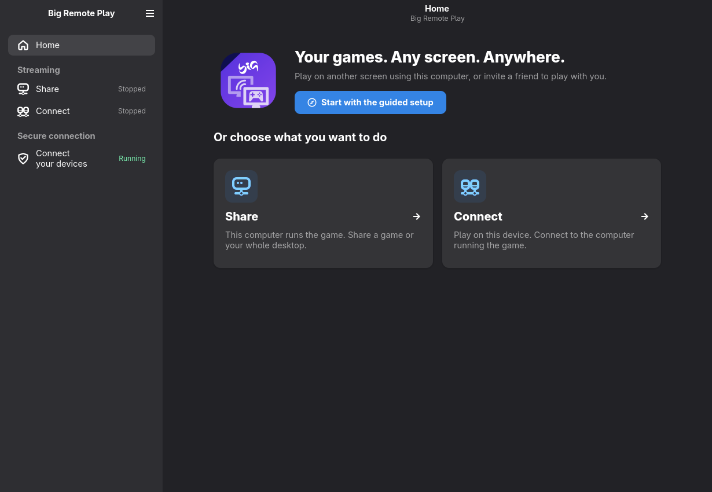
</p>

## Why Big Remote Play?

Remote play on Linux usually means learning several unrelated tools before the first connection works. Big Remote Play keeps those tools independent but gives you one task-oriented interface for the whole journey:

| | |
|---|---|
| 🎮 **Share a game** | Share the whole desktop with [Sunshine](https://github.com/LizardByte/Sunshine), start a Steam, Lutris or custom game, or send **only one game window**. The **Game Library** finds your installed Steam, Lutris and Heroic games and offers the ones you choose in Moonlight, plus ready-made entries: **Desktop Low**, **Steam Big Picture** and **one entry per screen** ([details](docs/moonlight-entries.md)). |
| 🖥️ **Connect from anywhere** | Find the game computer and play it with [Moonlight](https://moonlight-stream.org/) on another PC, a TV or a laptop. |
| 🔒 **Play across the internet** | Put both computers on the same private network with Tailscale, Headscale or ZeroTier. No open router ports needed. On a friend's ZeroTier network, **Find computers to play on** finds the game PC without the owner's account. |
| 🕵️ **Keep your desktop private** | **Game Window** streams one game through a private screen: notifications, chats and other windows never reach the other device. |
| 🧭 **Guided from the first click** | **Start with the guided setup** asks what you want to do and where the other device is, installs what this computer needs without a terminal, then opens the right page. |
| 🔑 **Pair in seconds** | **Start sharing** is one large button, and **Pair a new device** keeps the PIN field in view. When Moonlight asks to pair, the request opens by itself: type the four digits and choose **Approve**. The first time, Sunshine's administrator password is created for you and kept in the system keyring. |
| 👥 **Play together** | Up to four devices can play on the same computer at once, each with its own controller: invite friends to a local multiplayer game from wherever they are. |
| 🖱️ **The pointer you can see** | When the screen capture leaves the mouse pointer out (KMS on KDE and GNOME Wayland), Share notices it in Sunshine's log and offers the capture that draws it. |
| 🖥️ **Every screen in its place** | Choose which monitor of the game PC is shared and on which screen of this computer the game opens. |
| 📱 **Play from a phone** | Touch, keyboard and controller instructions for Moonlight on Android and iPhone/iPad, with a QR code to read them on the phone. **Touch controls** puts an on-screen controller on the shared screen that takes several fingers at once, with the **Big Remote Play Controller** app on the phone ([how to install](#your-phone-as-a-controller-multi-touch)). |
| 🩺 **Help when something fails** | **Support** checks this computer without changing anything and explains common problems. If a stream drops because the network cannot carry it, Connect says so and offers **Lower quality and connect again**. |
| 🎮 **Controllers too** | Keyboard, mouse and controllers of the other device reach the game through Sunshine. While someone plays, **Share** says which controller arrived, or why none did. |
| 🔊 **Sound that just works** | Game audio is sent; the microphone and voice calls only when you turn them on. Everything returns to normal when sharing stops. |
| 🛡️ **Respects what you have** | Existing Sunshine libraries, paired devices, Moonlight identity and VPN profiles are preserved, never overwritten. |
| ♿ **Made for everyone** | Adaptive GTK 4/libadwaita interface for keyboard, touch, compact windows, high contrast, large text, RTL and CJK, in 32 languages. |

There is no proprietary game catalog and no requirement that the game came from a particular store. The game runs on your own computer; Big Remote Play coordinates the free-software components around it.

## Screenshots

<table>
  <tr>
    <td width="50%">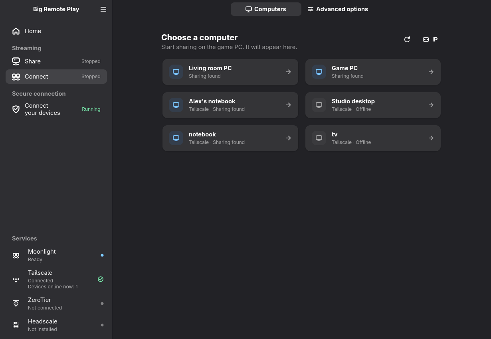<br><sub><b>Connect</b>: each computer is a card that says where it is and whether it is sharing.</sub></td>
    <td width="50%">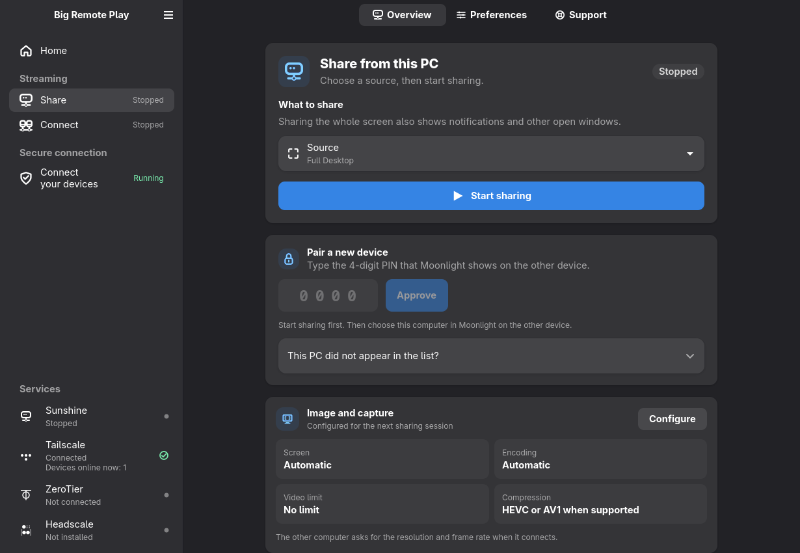<br><sub><b>Share</b>: the state in words, one main button and the PIN field always in view.</sub></td>
  </tr>
  <tr>
    <td>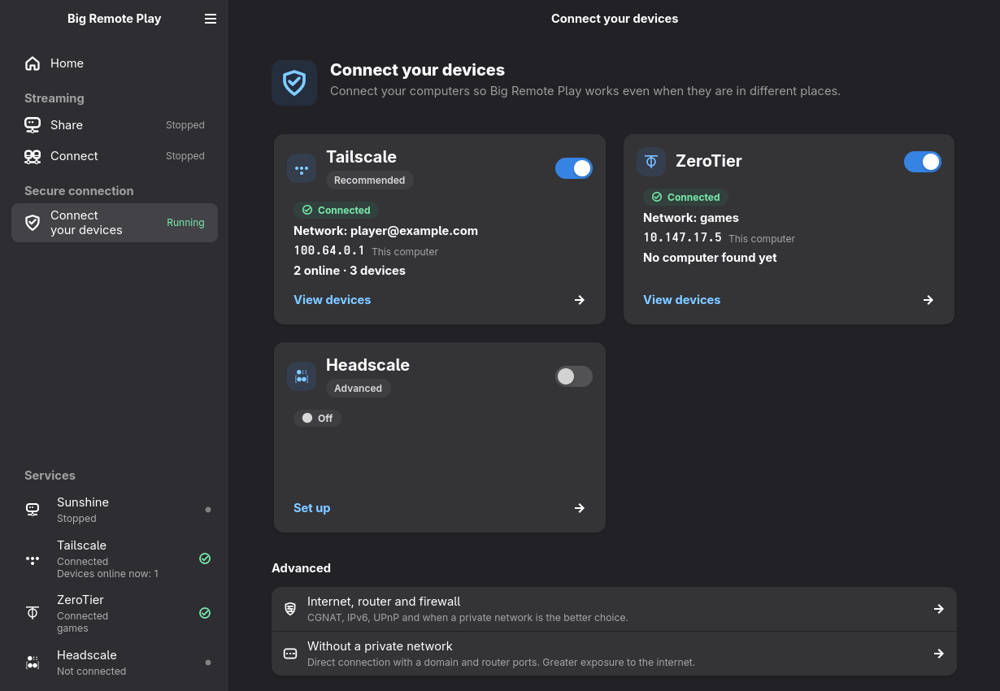<br><sub><b>Connect your devices</b>: each method with a real switch, its address and its devices.</sub></td>
    <td>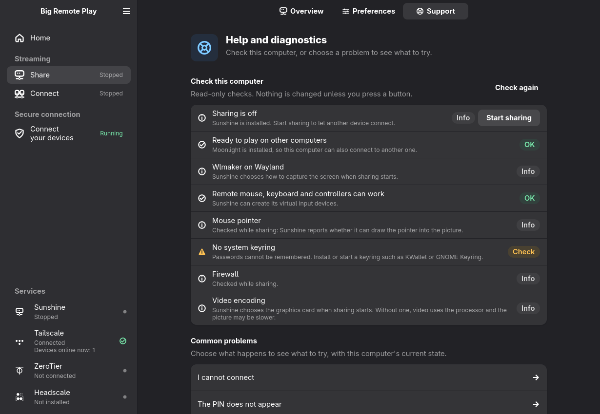<br><sub><b>Support</b>: read-only checks in plain words, then what to try for common problems.</sub></td>
  </tr>
  <tr>
    <td>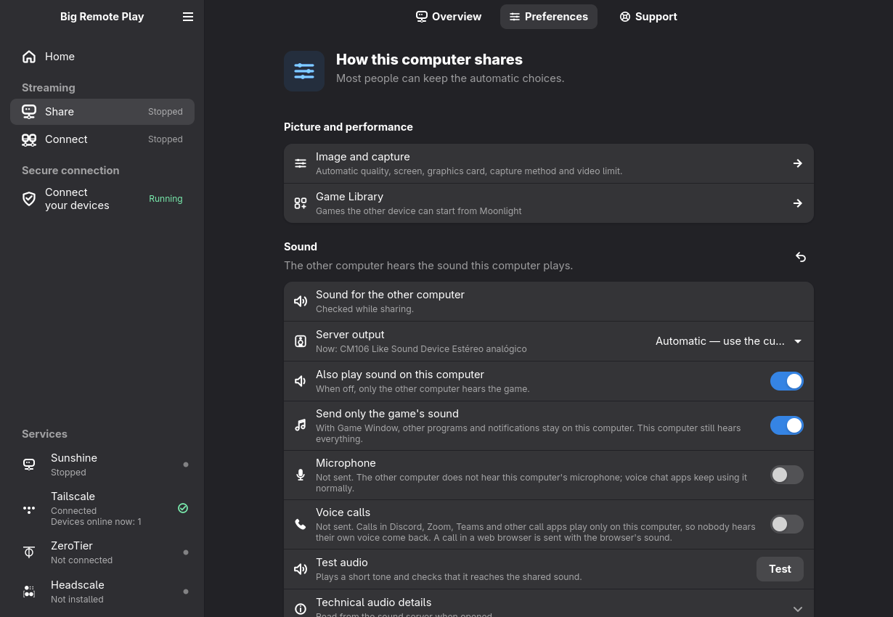<br><sub><b>Preferences</b>: grouped by purpose; most people keep the automatic choices.</sub></td>
    <td>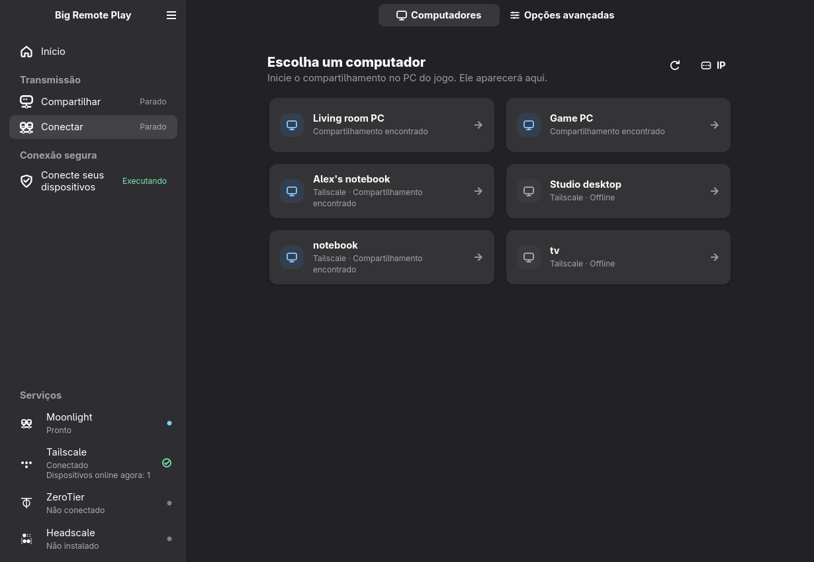<br><sub><b>32 languages</b>: here in Brazilian Portuguese.</sub></td>
  </tr>
  <tr>
    <td>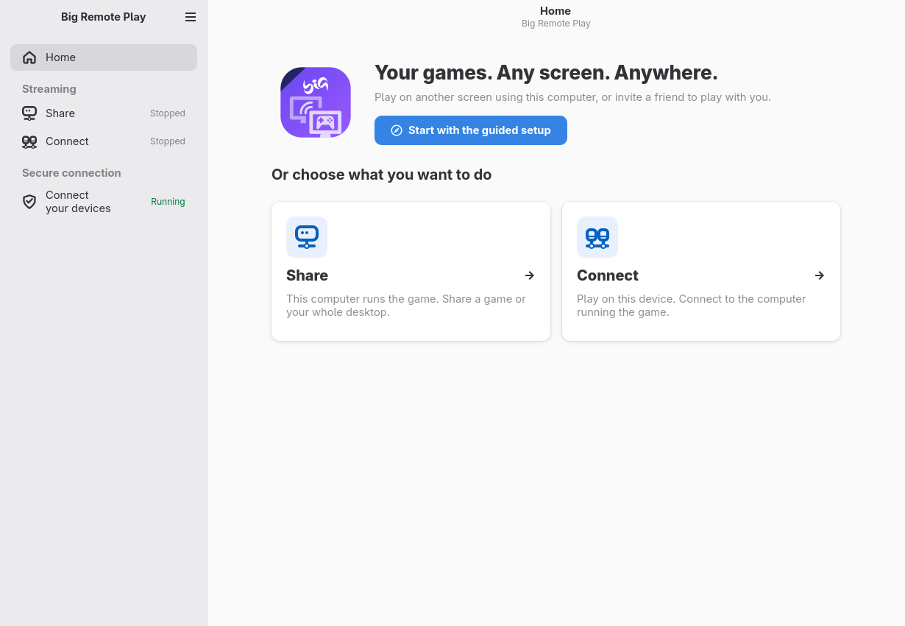<br><sub><b>Light</b>: Automatic follows the system; Light and Dark can be forced.</sub></td>
    <td>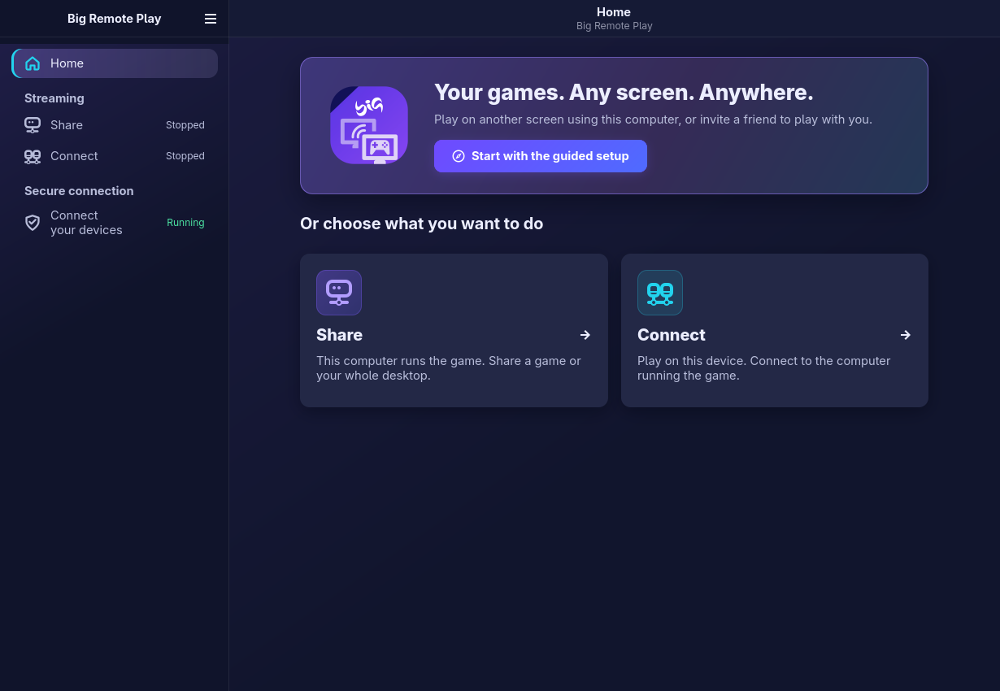<br><sub><b>Gamer appearance</b>: a dark, colorful preset over the same layout.</sub></td>
  </tr>
  <tr>
    <td>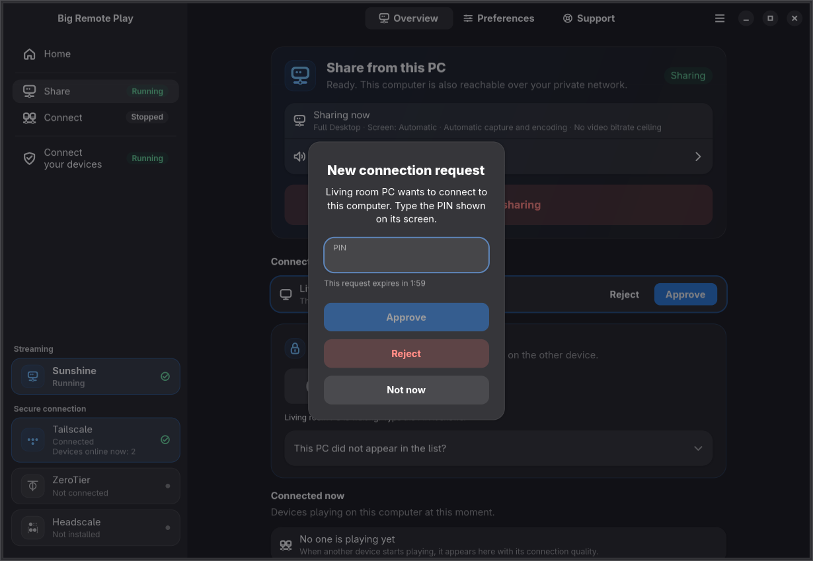<br><sub><b>New connection request</b>: opens by itself when a device asks to pair.</sub></td>
    <td>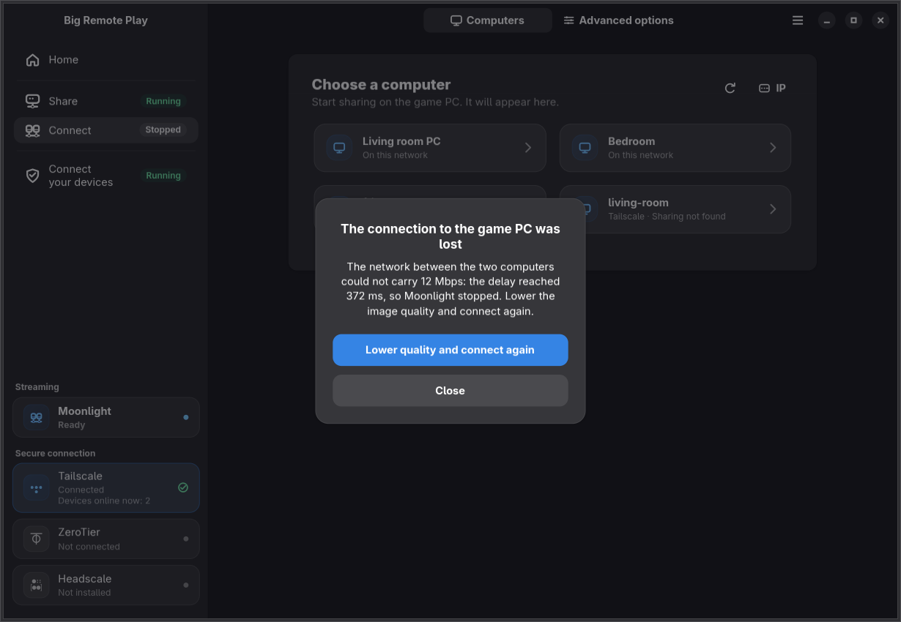<br><sub><b>A dropped stream, explained</b>: and one button to try again at a rate the network carries.</sub></td>
  </tr>
</table>

<sub>Screenshots use simulated games, devices and addresses.</sub>

## Try it in three steps

**1. On the computer running the game** — open **Share**, choose what to share and press **Start sharing**. Under **What to share**, **Game Window** sends only the game you pick; **Full Desktop** sends the whole screen. The first time, Big Remote Play creates Sunshine's administrator password for you and keeps it in the system keyring.

**2. On the computer that will play** — open **Connect** and choose the game computer. The first time, Moonlight shows a four-digit PIN, and the sharing computer opens **New connection request** by itself: type the PIN there and choose **Approve**. You can also type it any time under **Pair a new device**.

**Playing with friends?** Each friend repeats step 2 on their own computer. Up to four devices can play at once, each with its own controller.

**3. When the computers are in different places** — open **Connect your devices**. Choose **Tailscale** (recommended), **ZeroTier** or **Headscale**: each opens its own page with one button for the next step (**Install and continue**, **Set up**, **Sign in**, **Start**), its devices with **Copy IP**, and **Add device**. Not sure where to start? **Start with the guided setup** on Home asks two questions, prepares this computer and takes you there.

> **The PIN and the search code are different.** The PIN authorizes a device. A search code only helps find a Big Remote Play computer on a network that permits discovery.

The full walkthrough — audio, image quality, Game Window, direct public access and safety limits — is in the [user guide](docs/user-guide.md).

## Your phone as a controller (multi-touch)

**Touch controls** draws an on-screen controller on the shared screen of the game computer. You see it in the picture on your phone and press it with your fingers: a direction and **A** together, both sticks, triggers, up to five fingers at the same time. The game sees an ordinary controller, never a mouse.

<p align="center">
  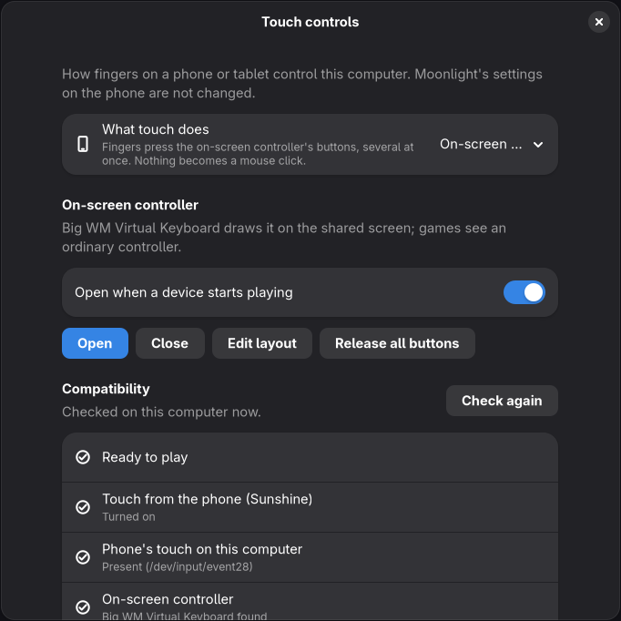
  <br><sub><b>Share → Preferences → Mouse, keyboard and controllers → Touch controls</b>, with simulated checks.</sub>
</p>

The official Moonlight for Android turns every finger into the mouse, so it cannot press two buttons at once. The phone needs **Big Remote Play Controller**: a build of Moonlight for Android 12.2 that sends every finger to the computer as its own touch. It is unofficial, has its own name and application ID (`io.github.bigremoteplay.controller`) and installs **next to** the official Moonlight without changing it. Its pairing and settings are separate.

### What you need

| Where | What |
|---|---|
| Phone or tablet | Android 5.0 or newer, with **Big Remote Play Controller** |
| Game computer | Big Remote Play, **Big WM Virtual Keyboard** with remote touch (`big-keyboard` 0.1.0-2 or newer) and Sunshine |
| Sunshine | **2026.1113 or newer**. Sunshine 2026.914 puts the touch above the finger when the picture has black bars, worst at the bottom of the screen; the fix is LizardByte/Sunshine@4062cb7 |

At the time of writing, the `big-keyboard` with remote touch is not yet in a package repository. Big Remote Play says **Update Big WM Virtual Keyboard: this version cannot read touch from the phone** when the installed one is older.

### 1. Download the app

**[Download Big Remote Play Controller 12.2-brpc2 (APK)](https://github.com/ruscher/big-remote-play/releases/download/controller-v12.2-brpc2/big-remote-play-controller-12.2-brpc2.apk)** · [release page](https://github.com/ruscher/big-remote-play/releases/tag/controller-v12.2-brpc2) · [source code](https://github.com/ruscher/moonlight-android-touch/tree/brp/native-touch) (GPL-3.0)

Before installing, you can check the file:

| | |
|---|---|
| SHA-256 of the APK | `a6cb6b48b02a5994a631690980cfe9d67665bd9e6905b71c2b0c06a0fdc6bc86` |
| Signing certificate (SHA-256) | `A2:8A:FA:C5:45:EC:5A:E3:5E:CC:87:F2:8E:BD:0A:69:90:F2:2F:C3:4B:3D:41:80:AD:3D:07:26:6C:71:C9:26` |

```bash
sha256sum big-remote-play-controller-12.2-brpc2.apk
apksigner verify --print-certs big-remote-play-controller-12.2-brpc2.apk   # from the Android SDK build-tools
```

### 2. Install it on the phone

**From the phone**

1. Open the download link above in the phone's browser and download the APK.
2. Open the downloaded file. Android asks to allow installing apps from this source (the browser or the file manager): allow it **only for that app**.
3. Tap **Install**, then **Open**.
4. Back in Android's settings, turn that permission off again.

**From a computer, with a USB cable**

1. On the phone: **Settings → About phone**, tap **Build number** seven times, then turn on **Developer options → USB debugging** (on Xiaomi phones also **Install via USB**).
2. Connect the cable, accept the computer's key on the phone, then on the computer:

```bash
sudo pacman -S --needed android-tools
adb devices
adb install big-remote-play-controller-12.2-brpc2.apk
```

To update, install the new APK over the old one (`adb install -r …`): pairing and settings are kept.

### 3. Turn it on

1. **Game computer** — open **Share → Preferences → Mouse, keyboard and controllers → Touch controls** and set **What touch does** to **On-screen controller**. Keep **Open when a device starts playing** on. Then press **Start sharing** (**Full Desktop**; with **Game Window** the phone sees only the game, not this controller).
2. **Phone** — open **Big Remote Play Controller**, choose the game computer and pair with the PIN, like in Moonlight.
3. In the app's **Settings**, **Send touch to the computer (multi-touch)** is already on. Leave **Show on-screen controls** off, or the game sees two controllers.
4. Open **Desktop**. The controller appears on the shared screen when the phone starts playing, and closes when the last device leaves. **Edit layout** moves and resizes the buttons from the phone.

**Compatibility** in the same sheet says what is ready and what is missing, in words. **Release all buttons** lets go of anything still pressed after a network drop.

### Resolution and black bars

The picture fills the phone without bars when the stream has the phone's shape and the shared monitor has a similar one. If the phone cannot decode the chosen resolution (many phones stop at 1920 pixels wide), the app now streams at the largest size with the same shape the phone accepts and says so, instead of failing with **error -5**. A monitor wider than the phone (for example 21:9) still leaves thin bars at the top and bottom, drawn by the computer.

Technical details, the test plan and measured results: [touch controls](docs/touch/03-arquitetura.md) and [phone controls](docs/mobile-controls.md#a-controller-drawn-by-the-game-pc-touch-controls).

## What's new

This release brings a calmer, native look and turns the phone into a controller. The phone part was checked on a real phone (Android, Redmi Note 11 Pro 5G) streaming a Wayland desktop (wlmaker, three monitors) with Shadow of the Tomb Raider through Steam; the full test plan, with what is still pending, is in [touch controls](docs/touch/08-validacao-android.md).

- **A calmer, native look** — the window now follows AshyWall's design: the menu at the top of the sidebar, places grouped under **Streaming** and **Secure connection**, each task's state as quiet text, services as ordinary rows, and plain native cards without gradients. Every page, setting and flow is the same ([design notes](docs/redesign/02-decisoes.md)).
- **Touch controls** — **Share → Preferences → Mouse, keyboard and controllers → Touch controls** opens the Big WM Virtual Keyboard's on-screen controller when a phone starts playing, releases it when a player leaves and closes it with the last one. Several fingers press several buttons; nothing becomes a mouse click ([details](#your-phone-as-a-controller-multi-touch)).
- **Big Remote Play Controller for Android** — a Moonlight 12.2 build that sends every finger as its own touch, installs next to the official Moonlight and picks a resolution the phone can decode instead of failing with error -5 ([download](https://github.com/ruscher/big-remote-play/releases/tag/controller-v12.2-brpc2)).
- **Host has priority keeps the controller working** — the host's mouse and keyboard still pause remote input, but never the touchscreen that drives the on-screen controller ([details](docs/host-input-priority.md)).
- **Touch where you put your finger** — with Sunshine 2026.914 the touch landed above the finger when the picture had black bars; Sunshine 2026.1113 fixes it, and the [touch notes](docs/touch/06-testes.md) explain how to tell.

Before that, finding things by themselves: your installed games, the computers on a friend's ZeroTier network and the right screen.

- **A game library that finds your games** — Steam (native and Flatpak, every library on every disk), Lutris and Heroic (Epic, GOG, Amazon). Only installed games are listed, Proton and Steam runtimes are left out, and you choose which ones Moonlight offers. It works with sharing off ([details](docs/game-library-detection.md)).
- **Computers on someone else's ZeroTier network** — **Find computers to play on** asks the network which computers share games, without the owner's ZeroTier account; they appear in **Connect** as **Ready to play** ([how it works](docs/zerotier-discovery.md)).
- **ZeroTier on and off without a password** — a helper limited to starting and stopping the private-network service, allowed for the person at the computer; no sudoers rule ([details](docs/zerotier-permissions.md)).
- **Choose the screen where the game opens** — **Connect → Image → Open on** opens Moonlight on the chosen screen of this computer on X11 ([several screens](docs/moonlight-multi-monitor.md)).
- **The shared monitor you chose, really shared** — on X11 the game PC now sends the monitor picked in **Share**, and each monitor is listed once instead of twice.
- **The mouse pointer on the phone with an X11 desktop** — with **Capture Method** on **Automatic**, an X11 session now uses X11 capture, which draws the pointer into the picture; KMS capture on X11 sent none and is now reported in **Needs attention** ([details](docs/mouse-cursor-compatibility.md)).
- **Controls on the phone** — **Shortcuts & Instructions** has a tab for Moonlight on a computer, Android, iPhone/iPad and controllers, and a QR code that opens the guide on the phone ([guide](docs/mobile-controls.md)).

Earlier: a simpler Share page, automatic pairing with Sunshine's password kept in the keyring, up to four players at once, streams that drop explained with **Lower quality and connect again**, and the mouse pointer on Wayland.

## Install

### BigLinux and Manjaro

Big Remote Play is packaged for BigLinux (currently in the `biglinux-testing` repository). The native package installs the application, launcher, icons, translations and desktop integration together:

```bash
sudo pacman -Syu big-remote-play
```

Then open the task you want: anything missing is listed in the app with **Install what's needed**, which installs it through Pamac or PolicyKit (your password is asked in the system's own window). It never installs software without that button. To install by hand instead:

```bash
sudo pacman -S --needed sunshine        # on the computer that shares games
sudo pacman -S --needed moonlight-qt    # on the computer that plays
```

Moonlight installed as a Flatpak (`com.moonlight_stream.Moonlight`) also works.

### Arch Linux

Every dependency of the package is in Arch's own repositories; no extra repository has to be added. Moonlight, Tailscale, ZeroTier, Headscale and Caddy are in `extra`. Sunshine is not in the Arch repositories: on the computer that shares games, install it from the AUR or from Sunshine's own package first. **Install what's needed** says so instead of failing.

### Build the package from source

`makepkg` run inside a checkout packages that checkout. Always build from an up-to-date checkout: an old clone carries an old recipe (one that copied only `usr/` installs a launcher without the application, which now says so in a window).

```bash
git clone https://github.com/ruscher/big-remote-play.git
cd big-remote-play/pkgbuild
makepkg -si
```

Set `BIGREMOTEPLAY_FROM_GIT=1` to build `ruscher/main` instead of the local checkout. The package version is dated automatically at build time (`YY.MM.DD`).

### Nix

```bash
nix run github:biglinux/big-remote-play
```

The flake dates each build from its commit (`YY.MM.DD`), like the native package. It does not include GStreamer, so add its plugins to the environment to use Game Window. The PolicyKit helpers and their `/usr` paths are not installed by Nix: on NixOS the actions that need administrator rights (firewall rules, a Headscale server, host input priority) are unavailable.

### Run from a checkout

With the GTK requirements installed from your distribution:

```bash
PYTHONPATH=src python3 -m big_remote_play
```

For an isolated editable environment that still uses the distribution's GI bindings:

```bash
uv venv --python /usr/bin/python3 --system-site-packages ../brp-dev-venv
uv pip install --python ../brp-dev-venv/bin/python --no-deps -e .
PYTHONPATH=src ../brp-dev-venv/bin/python -m big_remote_play
```

The Python wheel alone is not a complete desktop installation: icons, styles, translations and helpers live under `usr/share/`. See the [development guide](docs/development.md).

### Requirements

| | Packages (Arch/BigLinux names) |
|---|---|
| **Required** | `python` ≥ 3.11, `gtk4` ≥ 4.17, `libadwaita` ≥ 1.7, `glib2`, `gdk-pixbuf2`, `pango`, `python-gobject`, `python-cairo`, `libsecret`, `avahi`, `curl`, `iproute2`, `iputils`, `jq`, `polkit`, `procps-ng`, `systemd`, `util-linux`, `hicolor-icon-theme` |
| **Share** | `sunshine`; for the Game Library, the launchers whose games you offer: `steam`, `lutris`, Heroic Games Launcher (native or Flatpak); `miniupnpc` to open the game ports on the router (play over the internet without a VPN) |
| **Connect** | `moonlight-qt` (or the Moonlight Flatpak with `flatpak`) |
| **Game Window** | Sunshine ≥ 2026.516; KDE Plasma (`kwin`, `xdg-desktop-portal-kde`) on Wayland or an X11 desktop with compositing; `gst-plugin-pipewire`, `gst-plugins-base`, `gst-plugins-bad-libs`, `gst-plugins-good` |
| **Touch controls** | `big-keyboard` ≥ 0.1.0-2 (remote touch; ≥ 0.2.4 for the phone's touchpad-style mouse on Big WindowMaker with the keyboard and controller hidden) and Sunshine ≥ 2026.1113 on the game PC; the Big Remote Play Controller app on the phone ([install](#your-phone-as-a-controller-multi-touch)) |
| **Connect your devices** | one of `tailscale` or `zerotier-one`; to host your own Headscale server on this computer, `headscale` and `caddy` (`miniupnpc` reads the router's public address) |
| **Optional** | a Secret Service provider (GNOME Keyring or KWallet) for saved passwords, `libpulse` and `pipewire` for sound, `libkscreen` (screen mode and HDR for the connecting device), `pciutils` (graphics detection), `xorg-xrandr` (monitors and the main screen on X11), `flatpak` (Moonlight, VPN clients, Steam, Lutris or Heroic installed as Flatpaks), `xdg-utils` (start Heroic games when only its link handler exists). Pamac is used to install components when it is present. |

## Game Window: share the game, not your desktop

Sunshine can only capture whole screens, so Game Window gives it a private one. A headless KWin screen holds nothing but a mirror of the chosen game; the desktop, panels, notifications and every window placed over the game simply do not exist there. If the game closes or crashes, sharing stops at once — it never falls back to the desktop.

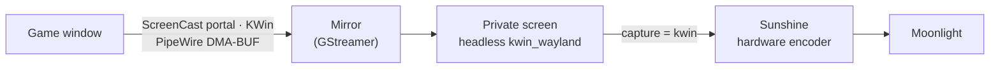

Games are listed by name from their process tree — Steam, Proton, Wine, Lutris, Heroic, Gamescope and native games — and the private screen runs at 240 Hz so the game picture is not held back. Design, safety rules, measurements and limits: [Game Window](docs/game-window.md).

## Technologies

| Area | What Big Remote Play uses |
|---|---|
| Language and UI | Python 3.11+, [GTK 4](https://gtk.org/), [libadwaita](https://gnome.pages.gitlab.gnome.org/libadwaita/), [PyGObject](https://pygobject.gnome.org/) |
| Streaming | [Sunshine](https://github.com/LizardByte/Sunshine) server (NVENC, VAAPI, Vulkan and software encoders) and [Moonlight Qt](https://github.com/moonlight-stream/moonlight-qt) client, configured through their native files and APIs |
| Game Window | [xdg-desktop-portal](https://flatpak.github.io/xdg-desktop-portal/) ScreenCast, [KWin](https://invent.kde.org/plasma/kwin) scripting and a headless `kwin_wayland`, [PipeWire](https://pipewire.org/) DMA-BUF, [GStreamer](https://gstreamer.freedesktop.org/); EWMH through `libX11` on X11 |
| Screen and colors | `kscreen-doctor` for HDR-to-SDR and per-session resolution, restored after every session |
| Audio | PipeWire/PulseAudio through `pactl` and `pw-link`: automatic output capture, voice calls kept out and the microphone left out unless you choose otherwise, PipeWire port links ("bridges") made by the app, which removes only what it created |
| Networks | mDNS discovery with [Avahi](https://avahi.org/); [Tailscale](https://tailscale.com/), [Headscale](https://headscale.net/) and [ZeroTier](https://www.zerotier.com/) clients and APIs; a bounded, on-demand search of ZeroTier networks for Sunshine |
| Touch controls | Sunshine's native touch (`native_pen_touch`) and its virtual touchscreen, read by the [Big WM Virtual Keyboard](https://github.com/big-windowmaker/big-keyboard) on-screen controller through evdev and turned into a `uinput` gamepad; the [Big Remote Play Controller](https://github.com/ruscher/moonlight-android-touch/tree/brp/native-touch) Android app (Moonlight 12.2) sends every finger |
| Games | Steam (`libraryfolders.vdf`, `appmanifest_*.acf`), Lutris (`pga.db`) and Heroic (Legendary, GOG, Nile) libraries, read-only |
| Security | Secret Service keyring (`libsecret`) for passwords and tokens, narrowly scoped PolicyKit helpers, ufw/firewalld checks, owner-only atomic writes |
| Internationalization | gettext, 32 translated catalogs (distinct `pt`/`pt_BR` and `zh_CN`/`zh_TW`) |
| Packaging | PEP 517 build on `uv_build`, private `/usr/lib/big-remote-play` layout that survives Python upgrades, PKGBUILD and Nix flake, reproducible `YY.MM.DD` versions |
| Quality | pytest (about 1,800 tests, GTK task flows under Xvfb and D-Bus), ruff, pyright, catalog and metadata validators |

How the pieces fit together is described in [architecture](docs/architecture.md) and the [host and network policy](docs/host-network-policy.md).

## Project status

The source tree runs automated checks for Python, GTK task flows, translations, desktop metadata, shell helpers, packaging and release hygiene. A stable release still requires target-machine validation of real streaming, GPU capture and encoding, audio routing, VPN sign-in, PolicyKit, keyring behavior and assistive technologies. See [release acceptance](docs/release-testing.md).

Version fields in the checkout stay at `0.0.0`. Builds derive `YY.MM.DD` automatically from `SOURCE_DATE_EPOCH`, or from the current UTC date when no reproducible-build epoch is supplied. Maintainers never edit version strings by hand.

## Documentation

| Audience | Start here |
|---|---|
| Players and helpers | [User guide](docs/user-guide.md), [troubleshooting](docs/troubleshooting.md), [Game Window](docs/game-window.md), [game library](docs/game-library-detection.md), [phone controls](docs/mobile-controls.md), [phone as a controller](#your-phone-as-a-controller-multi-touch), [several screens](docs/moonlight-multi-monitor.md) |
| ZeroTier | [Finding computers on a network](docs/zerotier-discovery.md), [no repeated passwords](docs/zerotier-permissions.md) |
| Playing over the internet | [Router, NAT and firewall](docs/router.md), [your own Headscale server](docs/vps-headscale.md), [Cloudflare](docs/cloudflare.md) |
| Contributors | [Contributing](CONTRIBUTING.md), [development](docs/development.md), [documentation index](docs/README.md) |
| UI contributors | [Visual design](docs/visual-design.md), [redesign notes](docs/redesign/01-auditoria.md), [UI instructions](src/big_remote_play/ui/AGENTS.md) |
| Touch controls (Portuguese) | [Architecture](docs/touch/03-arquitetura.md), [tests](docs/touch/06-testes.md), [Android test plan](docs/touch/08-validacao-android.md), [report](docs/touch/09-relatorio-final.md) |
| Maintainers | [Architecture](docs/architecture.md), [maintainer guide](docs/maintainer-guide.md), [release testing](docs/release-testing.md) |
| Repository rules | [AGENTS.md](AGENTS.md) and the nested `AGENTS.md` files |

## Contribute

Contributions are welcome in English or Portuguese. Good starting points:

- reproduce and document a bug;
- improve a confusing task flow;
- add a focused regression test;
- test real hardware, games or networks;
- review a translation in context;
- improve screenshots or user documentation.

Read [CONTRIBUTING.md](CONTRIBUTING.md) before opening a pull request. Reports are actionable when they include the versions, session type, network setup and sanitized evidence needed to reproduce the problem.

If Big Remote Play helps you, **star the repository**, test it on your hardware and share what worked — that feedback helps other Linux players find the project and helps maintainers prioritize real-world compatibility.

## Security and privacy

Run the app as your normal user. Pair only trusted computers. **Full Desktop** can show notifications and other windows; use **Game Window** to send only the game. Backups may contain private certificates: protect them like passwords.

Never publish passwords, API tokens, authentication keys, private certificates, unredacted backups or private network addresses. Report sensitive vulnerabilities privately through the [security policy](https://github.com/biglinux/big-remote-play/security/policy), not a public issue.

## Credits

**Author / Lead Developer:** Rafael Ruscher

- **Development:** Rafael Ruscher, with contributions from Bruno Gonçalves, Tales A. Mendonça and everyone in the [contributors list](https://github.com/biglinux/big-remote-play/graphs/contributors), for the **[BigLinux](https://www.biglinux.com.br/)** community.
- **Translations, testing and feedback:** the BigLinux community, whose real computers, games and networks shape every release.

## Acknowledgements

Big Remote Play stands on the shoulders of excellent free software. Thank you to:

- **[LizardByte](https://github.com/LizardByte)** for Sunshine, and the **[Moonlight Game Streaming Project](https://moonlight-stream.org/)** for Moonlight — the streaming heart of this app;
- **[GNOME](https://www.gnome.org/)** for GTK, libadwaita and PyGObject;
- **[AshyWall](https://github.com/big-comm/ashywall)** (BigCommunity), whose calm native design the interface follows;
- **[KDE](https://kde.org/)** for Plasma, KWin and xdg-desktop-portal-kde, which make Game Window possible;
- **[PipeWire](https://pipewire.org/)**, **[GStreamer](https://gstreamer.freedesktop.org/)**, **[freedesktop.org](https://www.freedesktop.org/)** and **[Avahi](https://avahi.org/)**;
- **[Tailscale](https://tailscale.com/)**, **[Headscale](https://github.com/juanfont/headscale)** and **[ZeroTier](https://www.zerotier.com/)** for private networking;
- **[Valve](https://www.valvesoftware.com/)** (Steam, Proton, Gamescope), **[Lutris](https://lutris.net/)**, **[Heroic](https://heroicgameslauncher.com/)** and **[Wine](https://www.winehq.org/)** for bringing so many games to Linux.

Their names and trademarks belong to their respective projects. Big Remote Play does not replace their security models, protocols or documentation.

## License

Big Remote Play is free software, licensed under **GPL-3.0-or-later**. See [COPYING](COPYING).
